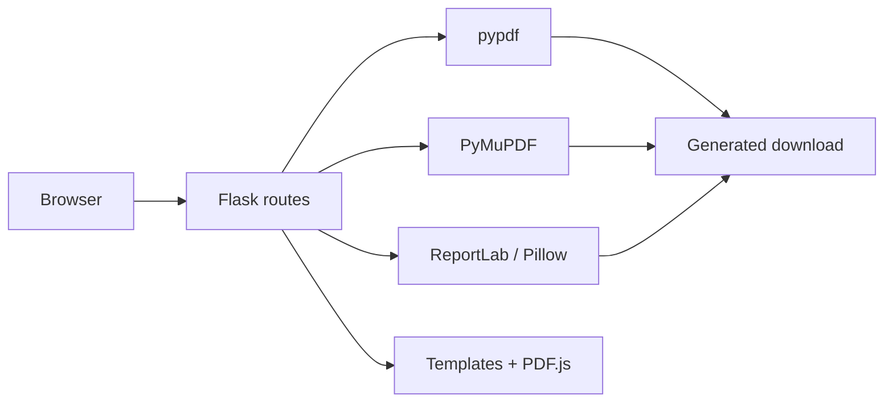

# PDF Toolkit Demo

A portfolio edition of a Flask web application that groups common PDF workflows—such as merge, split, crop, organize, conversion, protection and extraction—behind a responsive browser interface.

> **Portfolio edition:** This repository is a sanitized reference implementation. Production domains, analytics identifiers, runtime files, generated downloads and private Git history have been intentionally excluded. Branding and links have been replaced with demo-safe equivalents.

## What it demonstrates

- PDF organization: merge, split, reorder, rotate, crop, delete, extract and blank-page removal.
- Conversion workflows: images, Word, Excel, PowerPoint, HTML and web pages to and from PDF where supported by installed dependencies.
- Editing and security: watermarks, page numbers, metadata, redaction, password protection, unlocking and signatures.
- Browser-side experiences: PDF thumbnails, drag-to-reorder, interactive crop selection and client-side password prompts.
- SEO-oriented presentation: semantic headings, structured metadata, sitemap, robots file, breadcrumbs, FAQs and accessible navigation patterns.

## Architecture



## Source map

| Path | Purpose |
| --- | --- |
| `app.py` | Flask routes and PDF-processing logic |
| `templates/` | Jinja templates for each workflow |
| `static/css/style.css` | Shared responsive visual system |
| `static/js/merge.js` | Merge-PDF upload, preview and reordering behavior |
| `static/js/split.js` | Split / page-editor behavior |
| `static/robots.txt` | Crawling guidance for the demo site |

## Run locally

Requirements: Python 3.10+ and a virtual environment.

```bash
python3 -m venv venv
source venv/bin/activate
pip install -r requirements.txt
python3 app.py
```

Open `http://127.0.0.1:5000`.

Some optional conversion routes depend on the Python packages listed in `requirements.txt` and on the capabilities of the uploaded document. The app processes user-provided files in memory or into temporary download data; production deployments should add limits, malware scanning, background processing and appropriate data-retention controls.

## Validation

```bash
python3 -c "compile(open('app.py', encoding='utf-8').read(), 'app.py', 'exec'); print('Python syntax OK')"
```

## Portfolio relevance

This project demonstrates full-stack Python development, Flask routing, server-side document processing, responsive UI work, PDF.js integration, SEO fundamentals and safe public-repository preparation.
